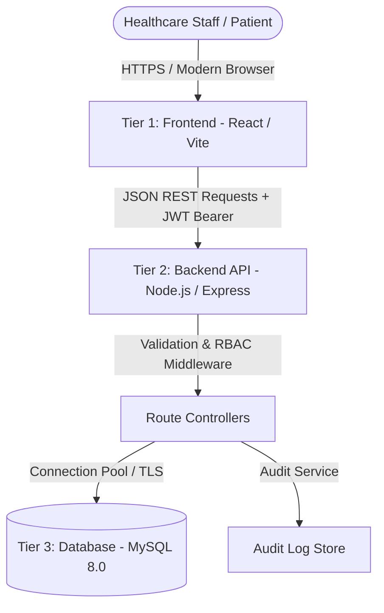

# HealthBridge: Final-Year Project Defence Handover & Technical Guide

**Candidate:** Boluwatife Ayomide  
**Project Title:** HealthBridge: An AI-Powered Electronic Health Record and Health Management System for Enhancing Healthcare Delivery in Nigerian Primary Healthcare Centres  
**Department:** Computer Science  

---

## 1. The Problem the Project Addresses

Primary Healthcare Centres (PHCs) are the first point of contact for over 70% of Nigeria's population, particularly in rural and semi-urban communities. Despite their importance, the majority of PHCs rely entirely on manual paper records. This causes critical operational issues:
- **Loss of Longitudinal Medical History**: Paper folders are easily misplaced, damaged by pests, water, or physical wear, leaving doctors without vital past medical histories during subsequent visits.
- **Duplicate Registrations**: Patients who forget their hospital cards are repeatedly registered as new patients, fragmenting their medical records and inflating clinic statistics.
- **Uncontrolled Drug Dispensing & Stockouts**: Pharmacies lack real-time synchronization with prescriptions, causing unmonitored stock exhaustion and delayed replenishments.
- **Diagnostic Bottlenecks**: Laboratory orders written on paper slips cause communication delays between doctors and technicians, increasing diagnostic turnaround times.
- **Compromised Patient Privacy**: Physical folders stored on open shelves are accessible to unauthorized individuals, violating patient confidentiality.

---

## 2. Why HealthBridge Was Developed

HealthBridge was developed as a cohesive, software-engineered response to the PHC crisis. Rather than attempting to introduce a complex, high-overhead Western hospital enterprise system (like Epic or Cerner) that requires extensive training and expensive local infrastructure, HealthBridge is:
- **Lightweight & Cloud-Native**: Operates seamlessly over standard web browsers without requiring local server hardware at the clinic.
- **Workflow-Aligned**: Designed around the exact operating sequence of a Nigerian primary care facility (Reception → Doctor Consultation → Pharmacy Dispensing / Laboratory Testing → Administration).
- **Resilient & Low-Cost**: Built with zero licensing fees using open-source, robust web technologies.
- **Accountable**: Built-in audit trails and role-based access enforce clinical governance.

---

## 3. Project Objectives

1. **Patient Registration & Identity Management**: Establish a unified, searchable electronic patient registry with validation to prevent duplicate entries.
2. **Clinical Consultation Management**: Provide doctors with structured interfaces to record chief complaints, vital signs, clinical diagnoses, and prescriptions.
3. **Integrated Pharmacy & Inventory Control**: Automate stock deduction upon drug dispensing and provide real-time alerts for low-stock and expiring medicines.
4. **Diagnostic Laboratory Pipeline**: Manage laboratory requests from order to specimen analysis and structured result reporting.
5. **Role-Based Access Control (RBAC)**: Enforce strict separation of duties between Receptionists, Clinicians, Pharmacists, Laboratory Technicians, and Administrators.
6. **Transparent Clinical Decision Support (CDS)**: Provide evidence-based, rule-driven clinical prompts (e.g., overdue follow-ups, abnormal results, missing allergy notes) without reliance on opaque third-party AI APIs.

---

## 4. System Architecture

HealthBridge implements a three-tier, decoupled client-server architecture:



- **Tier 1 (Presentation)**: Single Page Application (SPA) built with React 19 and Vite 5.4, deployed on Vercel's global Edge CDN.
- **Tier 2 (Application/API)**: RESTful Node.js/Express service deployed on Render, managing business logic, session validation, input sanitization, and security policies.
- **Tier 3 (Persistence)**: Relational MySQL 8.0 engine managed on Aiven with mandatory TLS encryption and strict foreign key integrity.

---

## 5. Why the Selected Technologies Were Used

- **React & Vite**:
  - React's component-based virtual DOM provides instant, snappy navigation between patient charts, tabs, and modals without full page reloads.
  - Vite offers lightning-fast builds, optimized bundle splitting, and zero runtime overhead.
- **Node.js & Express**:
  - Non-blocking, event-driven I/O allows the server to efficiently handle concurrent requests from multiple clinic departments simultaneously.
  - Express offers lightweight, battle-tested middleware pipelines for authentication, rate limiting, and RBAC.
- **MySQL**:
  - Relational database management systems (RDBMS) are essential for electronic health records where ACID compliance (Atomicity, Consistency, Isolation, Durability) is mandatory. Financial drug transactions, inventory adjustments, and patient-doctor links require strict relational integrity and cannot tolerate the eventual consistency or data corruption risks of NoSQL.
- **BCrypt & JWT**:
  - BCrypt with an adaptive work factor (10 salt rounds) protects against rainbow table attacks.
  - Stateless JSON Web Tokens (JWT) allow horizontally scalable authentication without needing server-side memory sessions.
- **CSS Design System (Deep Burgundy, Cream, Gold, Charcoal)**:
  - Custom responsive CSS adhering to high-contrast accessibility standards and an elegant clinical aesthetic, avoiding generic dashboard kits.

---

## 6. Frontend-to-Backend Request Flow

1. **User Action**: Healthcare worker performs an action (e.g., clicks "Schedule Appointment").
2. **API Client (`frontend/src/services/api.js`)**:
   - Inspects `localStorage` for `healthbridge_auth_token`.
   - Attaches `Authorization: Bearer <token>` and `Content-Type: application/json` headers.
   - Dispatches a `fetch()` request to `https://healthbridge-backend-5c3b.onrender.com/api/appointments`.
3. **Backend Middleware Pipeline (`server.js`)**:
   - `helmet()` checks security headers.
   - `cors()` verifies the request originates from an allowed origin (`healthbridge-boluwatife-ayomides-projects.vercel.app`).
   - `generalLimiter` verifies client IP has not exceeded rate quotas.
   - `authenticate` verifies JWT signature and expiry using `JWT_SECRET`.
   - `authorize('scheduleAppointment')` validates staff role against Table 3.10 RBAC matrix.
4. **Validation & Execution**:
   - Controller validates inputs (dates, times, IDs) using `lib/validation.js`.
   - Queries database via parameterized prepared statements.
5. **Response Envelope**:
   - Returns standard JSON: `{ "id": "APT-...", "status": "Scheduled", ... }` with HTTP 201.
   - Audit log recorded asynchronously.

---

## 7. Backend-to-MySQL Data Flow

- **Connection Pool**: The backend maintains a pooled connection (`mysql2/promise`) with a limit of 10 connections.
- **Connection Keep-Alive**: Because cloud databases close idle sockets, `enableKeepAlive: true` and `keepAliveInitialDelay: 10000` are configured.
- **Automatic Retry**: If an idle pooled socket drops (`PROTOCOL_CONNECTION_LOST`, `ECONNRESET`), `config/db.js` catches the socket error and retries the query once on a fresh connection.
- **TLS Security**: Handshake requires TLSv1.2+ and passes `aiven-ca.pem` certificate validation (`rejectUnauthorized: true`).
- **SQL Injection Prevention**: 100% of queries use positional parameter placeholders (`?`). String interpolation is strictly forbidden.

---

## 8. Database Design & Key Relationships

```
[branches]
   ▲
   │ (branch_id)
[staff] ──────┐ (doctor_id)
   ▲          │
   │          ▼
[patients] ─► [appointments]
   │  ▲
   │  └────────────────┐ (patient_id)
   ▼                   │
[consultations] ───────┴─► [prescriptions] ──► [prescription_items] ──► [medicines]
   │                             ▲
   └─► [lab_requests] ◄──────────┘
             ▲
             │ (lab_request_id)
       [lab_results]
```

- **`patients` table**: Stores demographics, emergency contact, blood group, genotype, allergies, condition, notes, and status (`Active`/`Inactive`).
- **`consultations` table**: Linked to `patients.id` and `staff.id`. Stores complaint, vitals (BP, pulse, temp, weight), diagnosis, and follow-up.
- **`prescriptions` & `prescription_items`**: Linked to `consultations.id`, `patients.id`, and `medicines.id`. Tracks status (`Pending`, `Dispensed`, `Cancelled`).
- **`medicines`**: Tracks inventory quantity, strength, unit price, and reorder levels. Dispensing automatically issues `UPDATE medicines SET stock_quantity = stock_quantity - ?`.
- **`lab_requests` & `lab_results`**: Links doctors' orders to laboratory tests, tracking status from `Pending` to `Completed`.

---

## 9. Purpose of Each User Role

| Role | Operational Scope | Key Permissions |
|---|---|---|
| **Administrator** | Governance & Operations | Manage staff accounts, system settings, facility analytics, view audit logs |
| **Receptionist** | Front Desk & Intake | Register patients, search records, schedule/update appointments, check-in |
| **Doctor** | Clinical Care | Review history, record consultations, diagnose, prescribe drugs, order tests |
| **Pharmacist** | Pharmacy & Inventory | View pending prescriptions, dispense medications, manage drug stock & catalog |
| **Laboratory Staff** | Diagnostics | View test orders, record diagnostic results, flag abnormal findings |
| **Patient** | Patient Portal | View personal profile, personal prescriptions, lab results, update password |

---

## 10. How Authentication and Authorization Work

1. **Staff Login**:
   - `POST /api/auth/login` receives `email` and `password`.
   - Backend queries `staff` table for the matching email.
   - `bcrypt.compare(password, user.password_hash)` verifies the hash.
   - If user is inactive (`status !== 'Active'`), returns HTTP 403 Forbidden.
   - Signs JWT payload: `{ id, fullName, email, role, branch, audience: 'staff' }`.
2. **Patient Login**:
   - `POST /api/patient-auth/login` authenticates registered patients.
   - Signs JWT payload with `audience: 'patient'`.
   - Middleware `staffOnly` rejects patient tokens attempting to access clinic backend routes, preventing privilege escalation.
3. **Role Authorization**:
   - `middleware/rbac.js` implements a strict permission matrix.
   - Example: A Pharmacist attempting `POST /api/consultations` receives `HTTP 403 Forbidden: You do not have permission to record consultations.`

---

## 11. Patient Registration & Search Workflows

- **Intake**: Receptionist collects full name, age, gender, phone, address, blood group, genotype, and initial medical complaint.
- **Duplicate Prevention**:
  - System checks for existing patients with matching normalized phone numbers or national IDs.
  - Prevents accidental creation of multiple charts for one individual.
- **Search**: Fast indexed prefix queries on `full_name`, `phone`, or `id`.
- **Patient Timeline**: Comprehensive chronological feed compiling all past appointments, consultations, prescriptions, and lab tests into a single consolidated view.

---

## 12. Appointments & Clinical Care Workflows

- **Appointment Scheduling**:
  - Prevents double-booking: Clinician cannot have two active appointments at the same date and time.
  - Rejects past dates and invalid time slots.
  - Links directly to the patient's record.
- **Clinical Encounter**:
  - Doctor reviews past timeline before or during examination.
  - Records chief complaint, examination findings, and vitals.
  - Records diagnosis and treatment plan.
  - Follow-up recommendation flags patients needing re-examination.

---

## 13. Pharmacy & Laboratory Workflows

- **Pharmacy Dispensing**:
  - Doctor issues prescription during consultation.
  - Prescription appears immediately on Pharmacist's "Pending Dispensing" queue.
  - Pharmacist verifies dosage and clicks "Dispense".
  - The system executes a database update:
    - Sets prescription status to `Dispensed`.
    - Decrements `medicines.stock_quantity` by prescribed amount.
    - If stock drops below `reorder_level`, medicine is automatically flagged as "Low Stock" on the Dashboard.
- **Laboratory Diagnostics**:
  - Doctor creates a lab order (`Fasting Blood Sugar`, `Urinalysis`, `Malaria Parasite`).
  - Request appears in Laboratory queue as `Pending`.
  - Lab technician conducts test and enters findings.
  - Status automatically transitions to `Completed`.
  - Finding is immediately available in the doctor's consultation view and patient timeline.

---

## 14. What the AI Features Actually Do

The project implements **evidence-based, rule-driven clinical intelligence** rather than generative hallucination:
- **Reviews Due**: Evaluates `last_visit < DATE_SUB(CURDATE(), INTERVAL 90 DAY)`.
- **Duplicate Records**: Groups records by normalized phone numbers where `COUNT(*) > 1`.
- **Incomplete Records**: Flags records missing baseline clinical information (allergies, condition, phone).
- **Abnormal Lab Results**: Scans completed results against clinically critical keywords (`positive`, `elevated`, `critical`, `abnormal`, `hbsag`, `trace protein`).
- **Unattended Follow-up**: Detects consultation follow-up dates where no subsequent appointment exists.
- **Workload Queue Analysis**: Real-time counter of actionable prescriptions and lab requests.

*Transparency Statement:* The API explicitly declares `isMachineLearning: false` and `method: 'rule-based analysis of the HealthBridge database'` to maintain medical safety and academic integrity.

---

## 15. Testing Performed & Verification Results

1. **Automated Backend Acceptance Suite (`backend/scripts/acceptanceTest.js`)**:
   - **Total Tests**: 119
   - **Passed**: 119
   - **Failed**: 0
   - **Coverage**: Authentication, RBAC privilege enforcement, patient CRUD, appointment conflict checks, clinical timeline, prescription dispensing and inventory decrement, lab result lifecycle, audit logging, patient portal, and envelope backwards compatibility.
2. **Local API Integration Suite (`test-local-api.cjs`)**:
   - **Total Checks**: 28
   - **Passed**: 28
   - **Failed**: 0
3. **Frontend Compilation & Bundle Verification (`deploy/deploy-frontend.js`)**:
   - Local build succeeds in 2.58 seconds.
   - Vite bundle outputs clean assets without broken imports.
   - Verifies bundle points to production Render API and contains no localhost fallbacks.

---

## 16. Security & Privacy Controls Implemented

- **Password Hashing**: BCrypt with salt rounds = 10; raw passwords are never stored or logged.
- **Token Security**: JWT signed with 256-bit secret, 8-hour expiry, separated staff vs. patient audiences.
- **SQL Injection Prevention**: Parameterized queries across all database operations.
- **Cross-Site Scripting (XSS)**: React JSX automatic escaping; `helmet` security headers enabled.
- **Brute-Force Protection**: Tiered rate limiters:
  - 300 requests / 15 min globally.
  - 25 requests / 15 min on login endpoints.
  - 10 requests / 15 min on password reset endpoints.
- **Audit Logging**: Every login, patient creation, prescription dispensing, and lab result entry creates an immutable audit log entry.
- **Transport Layer Security**: HTTPS enforced on Vercel and Render; MySQL requires TLSv1.2 with CA certificate validation.

---

## 17. Current Limitations

1. **Email Service Configuration**: In production, reset links are logged to the server rather than dispatched via SMTP unless third-party SMTP credentials (e.g., SendGrid/Mailgun) are supplied in environment variables.
2. **Offline Local Cache**: The system requires an active internet connection to communicate with the cloud API.
3. **Biometric Integration**: Patient identification relies on phone numbers and national IDs rather than fingerprint/iris hardware scanners.
4. **Billing / Health Insurance**: National Health Insurance Authority (NHIA) billing integrations were excluded from the scope of this project.

---

## 18. Potential Future Improvements

1. **Offline-First PWA with Background Sync**: Implement IndexedDB local caching and Service Workers to allow doctors to document consultations even during network dropouts.
2. **SMS / USSD Appointment Notifications**: Integrate Nigerian SMS gateways (e.g., Termii) to alert patients of upcoming appointments or ready prescriptions.
3. **FHIR / HL7 Interoperability**: Support standard FHIR interfaces for transferring patient records between primary health centres and tertiary teaching hospitals.
4. **Edge AI Triage**: Deploy on-device quantized models for preliminary offline symptom assessment.

---

## 19. Practical Live-Demonstration Sequence

When presenting your defence, execute this 5-minute workflow:

1. **Public Presentation & Login**:
   - Open `https://healthbridge-boluwatife-ayomides-projects.vercel.app`.
   - Highlight the clean typography (Fraunces & Inter), color scheme, and healthcare mission.
   - Sign in as Administrator (`admin@healthbridge.org` / `HealthBridge2026`).
2. **Administrative Oversight & Dashboard**:
   - Show the dynamic dashboard metrics (Total Patients, Appointments Today, Low Stock Items, Recent Activity).
   - Show that clicking "Inventory Attention" links directly to the affected drug.
3. **Receptionist Workflow (Patient Intake)**:
   - Switch user or open "Patient Records".
   - Search for an existing patient (e.g., "Demo").
   - Click "Register Patient" and register a test patient.
   - Schedule an appointment with Dr. Ngozi Eze.
4. **Doctor Workflow (Consultation & Clinical Orders)**:
   - Navigate to "Clinical Care" or patient detail.
   - Record a new consultation: Chief complaint (e.g., "Fever and chills for 3 days"), vitals (BP 120/80), diagnosis ("Acute uncomplicated malaria").
   - Issue a prescription for Artemether/Lumefantrine and order a Malaria Parasite (MP) blood test.
5. **Pharmacy & Laboratory Execution**:
   - Open "Laboratory", locate the test order, and record the result ("MP seen ++").
   - Open "Pharmacy", locate the prescription, note the current stock quantity, click "Dispense", and show the stock quantity decrementing in real time.
6. **AI Insights & Audit Log**:
   - Open "AI Insights" to show the transparent, rule-based clinical alerts (reviews due, incomplete records, abnormal findings).
   - Open "Audit Logs" to show the immutable record of all actions performed during the demonstration.

---

## 20. Likely Defence Questions & Technically Accurate Answers

**Q1: Why did you choose MySQL instead of MongoDB for an Electronic Health Record system?**  
*Answer:* Healthcare data is fundamentally relational and requires strict ACID transactional guarantees. Relationships between patients, clinical encounters, prescriptions, and pharmacy inventory cannot tolerate the eventual consistency risks of document stores. When dispensing a prescription, the prescription status update and inventory decrement must be atomic. MySQL's relational integrity and foreign key constraints guarantee data correctness.

**Q2: How does HealthBridge prevent unauthorized access between staff roles?**  
*Answer:* HealthBridge enforces role-based access control (RBAC) both on the client and strictly on the server. Every authenticated API request carries a JWT signed with a secret key. In the backend, `middleware/rbac.js` intercepts every protected endpoint and verifies whether the user's role has explicit permission in the authorization matrix. Even if a user attempts to send direct HTTP requests via Postman or curl, unauthorized endpoints return HTTP 403 Forbidden.

**Q3: Is the AI feature using a neural network or machine learning model?**  
*Answer:* In accordance with the documented project scope and medical safety principles, HealthBridge deliberately implements deterministic, rule-based Clinical Decision Support (CDS) rather than an unconstrained generative AI model. Using large language models in a primary health centre without local doctor supervision introduces risks of hallucinated dosages or misdiagnoses. Our system computes transparent signals—such as detecting duplicate patient records by phone matching, flagging abnormal lab keywords, and identifying missed clinical follow-ups—ensuring every recommendation is traceable and explainable.

**Q4: How do you protect patient passwords and sensitive data?**  
*Answer:* Passwords are never stored in plaintext. They are hashed using BCrypt with an adaptive work factor of 10 salt rounds before persistence. All communication between the frontend, backend, and database is encrypted in transit over TLS/HTTPS. Additionally, the backend uses parameterized prepared queries to completely eliminate SQL injection vulnerabilities.

**Q5: What happens if the database connection drops while the server is running?**  
*Answer:* The backend connection pool includes built-in keep-alive packets and automatic reconnection logic. In `config/db.js`, dropped sockets (e.g., `PROTOCOL_CONNECTION_LOST` or `ECONNRESET`) are caught and the statement is retried once on a fresh connection, preventing spurious 500 errors. If the database is completely unreachable, the server gracefully enters a read-only fallback mode while alerting administrators via the `/api/health` probe.
